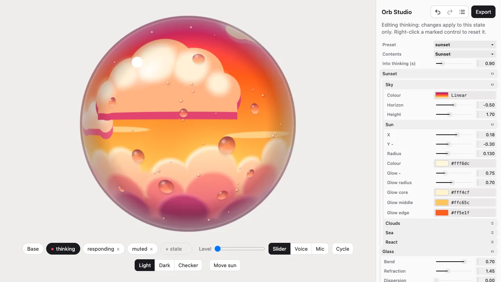

# 🔮 Orb Studio

Design a glass orb in your browser, then drop it into your app. Fill it with swirling colours, a picture, a video or a small scene. Give it states for listening, thinking and speaking, and let it respond to audio.

**[Open the studio](https://orb-studio-6ak.pages.dev)** · or [run it locally](#from-studio-to-your-app).



## From Studio to your app

1. **Pick a look.** Start with clear glass, a gradient, a landscape or a sunset, then adjust the glass, lighting and contents.
2. **Give it states.** Edit the base appearance or choose a state to change just that state. Try the level slider, simulated voice or microphone to see how it reacts.
3. **Export.** Pick your framework and copy the code. Download `poster.png` for the web fallback, or `program.json` for a native app.
4. **Paste it in.** Install the package named in the snippet and add the component to your app. Change its state as your app changes.

To run Studio locally, you need Node 20.19+ and [pnpm](https://pnpm.io):

```sh
pnpm install
pnpm dev
```

Open the localhost URL printed in the terminal. Studio saves your work in the browser. Undo, redo and version history let you try things without losing an earlier design.

## Quick start with React

```sh
pnpm add @orb3d/react
```

```tsx
import { Orb3D } from "@orb3d/react";

<Orb3D preset="aura" state="thinking" poster="/orb.png" style={{ width: 96, height: 96 }} />;
```

Change `state` to move smoothly between looks. The built-in presets include `idle`, `listening`, `thinking`, `speaking` and `muted`. Studio starts with a smaller set you can edit: `thinking`, `responding` and `muted`.

For audio, use the ref to feed a level from 0 to 1 without rendering React on every frame:

```tsx
import { useRef } from "react";
import { Orb3D, type OrbHandle } from "@orb3d/react";

function VoiceOrb() {
  const orb = useRef<OrbHandle>(null);
  // In your audio analyser loop: orb.current?.setLevel(rms * 6);
  return <Orb3D ref={orb} preset="aura" state="speaking" style={{ width: 96, height: 96 }} />;
}
```

Use `config` to change the design. It merges with the preset, so you only need to supply the parts you want to change:

```tsx
<Orb3D
  config={{ contents: { type: "image", src: "/avatar.jpg" }, glass: { frost: 0.15 } }}
  style={{ width: 160, height: 160 }}
/>
```

## What you can make

- **Glass:** refraction, colour fringing, frost, tint, reflections, highlights, rims, halos and shadows.
- **Contents:** clear glass, gradients, images, looping videos, a sunset, a 3D landscape, a day or night sky, or your own shader.
- **Colour:** solid, linear, radial, conic and mesh fills, with draggable colour points.
- **Weather:** rain on the glass, settling snow, condensation, sunshine, clouds, haze, lightning, hail and ice. Use an orb, a full-page sky or a transparent weather overlay.
- **States:** custom names and per-state settings, with smooth transitions and optional audio response.

Presets include `clear`, `aura`, `landscape`, `sunset`, `dawn`, `storm` and `night`. The shader editor shows compile errors while keeping the last working preview visible.

Weather can also follow observations from your app through `setWeather()`. The [weather guide](docs/weather-integration.md) covers units, provider adapters and examples.

## Use it anywhere

| Platform                   | Integration                                          | Renderer                 |
| -------------------------- | ---------------------------------------------------- | ------------------------ |
| React                      | [@orb3d/react](packages/react)                       | WebGL2                   |
| Vue, Svelte or plain HTML  | [@orb3d/element](packages/element), `<orb-3d>`       | WebGL2                   |
| JavaScript or a CDN script | [@orb3d/core](packages/core)                         | WebGL2                   |
| React Native or Expo       | [@orb3d/react-native](packages/react-native)         | React Native Skia 2 or 3 |
| SwiftUI, UIKit or AppKit   | [Orb3D Swift package](native/apple)                  | Metal                    |
| Android views or Compose   | [Android source / local AAR preview](native/android) | GLES 3.0                 |

The same shader and configuration power every renderer. Native apps use the compiled program exported by Studio; images and videos use each platform’s media loader.

For plain HTML, install `@orb3d/element`, import it and add `<orb-3d>`:

```html
<script type="module">
  import "@orb3d/element";
</script>

<orb-3d preset="aura" state="thinking" poster="/orb.png" style="width: 96px; height: 96px">
</orb-3d>
```

Without a bundler, use the standalone build:

```html
<div id="orb" style="width: 96px; height: 96px"></div>
<script type="module">
  import { mountOrb, PRESETS } from "https://esm.sh/@orb3d/core/standalone";
  const orb = mountOrb(document.getElementById("orb"), PRESETS.aura(), { poster: "/orb.png" });
  orb.setState("thinking");
</script>
```

## Exports

Studio exports framework snippets, the editable JSON config, a compiled `program.json`, a poster PNG, a self-contained HTML page and a share link. The HTML export includes its runtime and media, so it can be opened on its own.

To render posters in a build instead, `orb3d poster` draws one from a preset or an exported config: see [@orb3d/core](packages/core/README.md#posters).

Small image files stay in your saved design. Larger files and videos use temporary browser URLs; host them and replace the source URL before putting the design in your app. Undo history keeps earlier files available until you reload.

## How it behaves on a page

Web components show a poster first, then load the renderer when they approach the viewport. They keep the poster if WebGL2 is unavailable, the browser uses software rendering, Save-Data is enabled, or loading fails. Add a poster if you need a visible fallback.

The renderer pauses offscreen and in hidden tabs, limits pixel density, and respects reduced motion by holding a still frame and switching states without animation. Optional adaptive quality lowers live resolution when frames are slow; exports keep their requested resolution.

Clear glass reflects a simulated environment. It cannot refract the HTML behind the canvas. Images from another origin need CORS enabled, and the raymarched landscape is best kept small on slower devices. Android is currently a source and local AAR preview.

Safari paints no WebGL canvas inside an SVG `<foreignObject>`, so an orb placed there stays blank. To make an orb part of an SVG, such as the o of a wordmark, position it over the SVG instead.

## More detail

The [design reference](docs/reference.md) covers every kind of contents, glass controls, state transitions and rendering limits. See [colour fields](docs/color-fields.md), [weather integration](docs/weather-integration.md) and [performance](docs/performance.md) for deeper examples.

For development, testing and native builds, read [Contributing](CONTRIBUTING.md). [Deploy](DEPLOY.md) covers publishing the packages and hosting Studio.

Built by [Amir Abushanab](https://github.com/Amir-Abushanab). The `sunset` preset is based on the Plovent mark. Like [Wave Studio](https://github.com/Amir-Abushanab/wave3d), Orb Studio lets you design in the browser and take the result into your own app.

[MIT](LICENSE).
